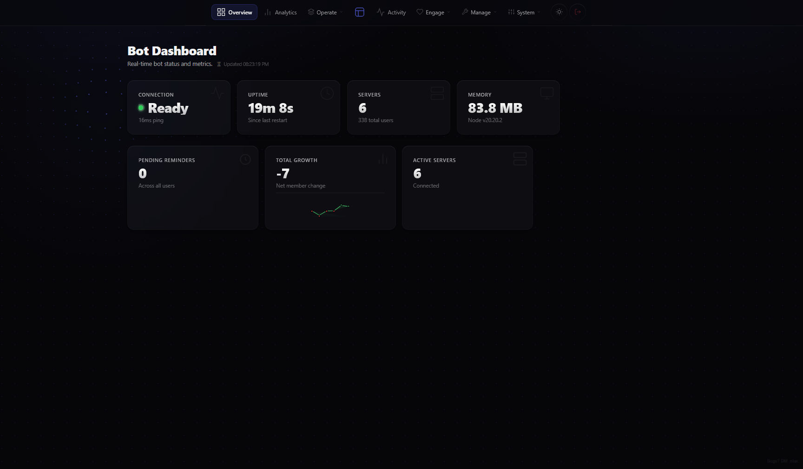
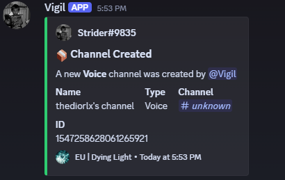
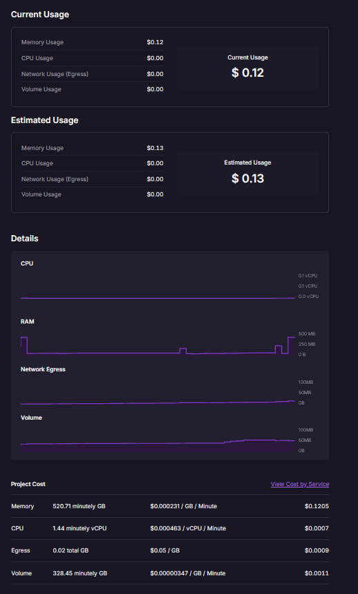
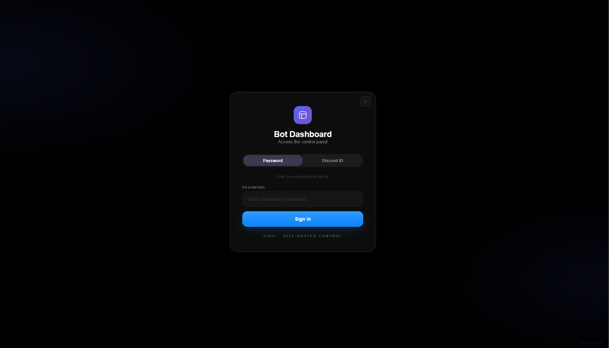

<div align="center">

# Vigil

**One bot instead of five subscriptions you don't own.**

Moderation with case files · 18 kinds of logging · tickets with transcripts · temp roles · a small API for your own tools · and a dashboard that runs in a browser tab.

[](https://github.com/francLunevro/Vigil-the-only-needed-bot/actions/workflows/ci.yml)
[](#the-tests)
[](https://nodejs.org)
[](https://discord.js.org)
[](LICENSE)

Deploy it yourself, free: [Railway](https://railway.app/new) · [Render](https://dashboard.render.com/select-repo?type=web) · [Docker](#docker)

</div>

---

I run Discord servers. A few years of that and I got tired of paying monthly for things a bot could do: reaction roles behind a paywall, logs I couldn't search, a ticket system that forgot everything the moment a channel got deleted.

So I built this instead. It's been running my communities more or less nonstop since, through restarts, redeploys, and every Discord outage in between. It's infrastructure first and a project second — which is why there's no Redis in here, and why the whole thing is one Node process with one SQLite file next to it.

This doc is long on purpose: every command, every environment variable, and the reasoning behind the decisions that look odd until you know why. I wrote it for the version of me who comes back in six months having forgotten all of it. So search it. Ctrl+F, find the thing, move on.

Two things I'd want to know up front:

- **Every command works both ways.** Slash and prefix (`;` by default). Same code underneath, same cooldowns, same permissions. The prefix side isn't a second-class citizen.
- **I tell you what's broken.** There's a whole section at the [bottom](#things-that-are-still-broken) listing the bugs and half-finished bits, including the ones that are my fault. Read it before you promise your community a feature.

If you just want the numbers: 76 commands (23 of them public), 18 categories of logging, 57 tables in one file, 537 tests, and a hosting bill around a dollar a month.

Jump to: [Look at it](#look-at-it) · [What you get](#what-you-actually-get) · [The dashboard](#the-dashboard) · [The API](#the-api) · [Setup](#getting-it-running) · [Config](#configuration) · [Data](#where-the-data-lives) · [How it's built](#how-its-built) · [Tests](#the-tests) · [Security](#security) · [Deploy](#deploying) · [Cost](#what-it-costs) · [When it breaks](#when-something-goes-wrong) · [**Things that are broken**](#things-that-are-still-broken) · [License](#license)

---

## Look at it

The dashboard. This is what you get after you log in — live connection, uptime, servers, memory, growth:

<p align="center"></p>

A log entry in Discord. Real one, not a mockup:

<p align="center"></p>

And what it costs me. This is my actual Railway page, four days into a billing cycle:

<p align="center"></p>

Twelve cents in four days. By the end of the month it lands somewhere between ninety cents and a dollar ten, and that's the entire bill — no tiers, no "premium", nobody's card on file but mine. You trade five dollars a month for about ten minutes of setup. I think that's a good trade, but it's a trade.

---

## What you actually get

Commands are listed with their real names. Slash and prefix both work for all of them; `;` is the default prefix and you can change it per server.

### 🛡️ Moderation

The usual set, plus the thing that separates a real mod bot from a toy: **every action opens a numbered case**. Who, what, when, why. Your staff always has the receipt.

| Command | What it does |
|---|---|
| `/kick` | Kick someone. Asks you to confirm, because I've fat-fingered this |
| `/ban` | Ban them, and optionally delete their last hour / six / twenty-four hours of messages |
| `/tempban` | Ban for a set time (`1h` through `30d`). The unban survives restarts — the expiry is a database row, and a sweeper lifts it even if the bot was offline when the timer ran out |
| `/unban` | Unban by user ID |
| `/timeout` / `/untimeout` | Time someone out (`60s` through `7d`), or take it back |
| `/warn` | Warn them, and DM them about it |
| `/warnings` / `/clearwarnings` | Look at or clear the history |
| `/lock` / `/unlock` | Lock a channel down |
| `/purge` | Bulk-delete up to 100 messages |
| `/slowmode` | Set slowmode |
| `/nickname` | Rename someone |
| `/role` | Add or remove a role from someone |

Then the case files: `/history @someone` for their whole record, `/case 12` for one case in detail, and `/reason 12 appeal approved, lifted early` to fix the reason later. That last one exists because punishments get reversed, and an audit trail that lies about why is worse than no audit trail.

**Rank is respected, and it's checked properly.** A moderator you granted `/ban` can't use it on someone above them, and can't hand out a role above their own highest one. The check compares the *person who ran the command* against the target — not the bot, which is what the old code did, and meant a grant was basically a licence to kick the admins. Owner accounts skip the check, and the confirm buttons re-check it when you click, in case roles moved while the prompt was open.

### ⏳ Temporary roles

`/temprole add @user @role duration:2h30m reason:…` and it comes off when the time's up. `/temprole remove` for early, `/temprole list` to see what's pending.

Most of the code here is failure handling, because that's what a temp role really is. The expiry lives in the database, so a restart doesn't lose it. If the bot gives someone a role and then can't record it, it takes the role back off rather than leaving an untracked permanent one behind. If they leave and rejoin while the timer's still running, they get it again. If the role or the member is gone, the row gets dropped loudly instead of retrying forever.

### 📜 Logging

Eighteen categories, each one routable to its own channel and each one switchable:

`messages` · `reactions` · `members` · `roles` · `server` · `voice` · `threads` · `emojis` · `bans` · `moderation` · `invites` · `stickers` · `automod` · `scheduled` · `stage` · `applications` · `webhooks` · `integrations`

`/log channel type:messages #mod-logs` sends one category somewhere specific. `/log toggle category:messages enabled:true` turns one off. Leave the channel unset and it goes to your default. Everything inherits your embed colour and footer from `/embedconfig`, so the whole log has one look instead of six.

The list above isn't decoration — it's the same array the dispatcher, the command choices and the dashboard all read from. That wasn't always true. `moderation` and `applications` were once logging fine but impossible to configure, because two places hardcoded sixteen categories and the other two knew about eighteen. A test now fails if they ever disagree again.

Deleted messages stay in the log, and stay searchable. Discord won't do that for you, and it matters more than you'd expect.

### 🔍 Searching the log

`/logs search` filters stored messages by user, keyword, and whether they were deleted or edited. Fifty results at a time. Every mod team ends up needing this: someone says something awful, deletes it, and assumes it's gone. It isn't, and I've settled more arguments with this than with anything else in the bot. If you'd rather poke through it in a spreadsheet, the dashboard exports the same rows as CSV.

### 🤖 Auto-mod

Five rules, each with its own threshold and its own response.

| Rule | Fires when |
|---|---|
| Spam | X messages in Y seconds |
| Mass mentions | More than X mentions in one message |
| Banned words | A word on your list shows up |
| Links | Any link, or any link not on your allowlist |
| Excessive caps | More than 70% caps in a message over 20 characters |

Each one can warn, delete, time out (for however long you choose), or kick. The word and link lists are managed with `/automod filter type:words pattern:spam`. There's an exemption system too — channels where nothing runs, roles the rules ignore — and the whole config imports and exports from the dashboard.

One performance note, because it bit us: the message path used to hit SQLite five or six times per message for config that only changes when a moderator edits it. It's cached per guild now, and the module that writes it invalidates it. So a new banned word takes effect on the next message, not the next hour.

### ⚖️ Warning thresholds

Warnings are only useful if something happens when they pile up:

```
/thresholds add warnings:3 action:timeout duration:60   → three warnings, one hour off
/thresholds add warnings:5 action:kick                  → five, kicked
/thresholds add warnings:7 action:ban                   → seven, banned
```

Build whatever ladder fits your server. Editable from the dashboard too.

### 🔐 Permissions

Instead of one "trusted" role that can do everything, Vigil grants one command to one person:

```
/perm grant @mod /ban        → this person can ban
/perm grant @trial-mod /kick → this one can only kick
/perm user @mod              → and this shows what they've got
```

Grants are per server, stored in the database, and cached for thirty seconds. So revoking takes effect about immediately, and the bot isn't querying for every command. The owner can always do everything. There is no half-admin role quietly doing too much.

One thing changed recently and it surprised people, so here it is plainly. Discord refuses to *show* commands you don't have permission for, and until this release nothing told Discord which permission each command needed — so `/kick`, `/ban` and `/automod` were sitting in every member's command list. They're now split into two tiers: moderation needs **Moderate Members**, server config needs **Manage Server**, and everything's registered per-guild only.

The catch: Discord enforces that field itself. So if you grant someone `/kick` with `/perm`, they *also* need the Discord **Moderate Members** permission to use the slash version. The prefix version doesn't care — Discord has no say over prefixes — so `;kick` still works on the grant alone. The list of which command sits in which tier is in `src/commandPolicy.js`, and a test fails if a new command isn't classified.

### 🎫 Tickets

This is the biggest system in here. Panels are what people click; types are the flavours of ticket inside a panel, each with its own team and its own questions.

Set one up:

```
/ticket panel_create name:Support
/ticket type_add panel:Support name:General
```

Then configure the type: where channels spawn (`type_category`), who sees it (`type_role`), what it says when it opens (`type_welcome`), and what to ask before opening it (`type_question` — answers land in the ticket).

Day to day: `/ticket claim`, `add`/`remove` people, `rename`, `close` with a reason. Plus `blacklist_add` for people who shouldn't be able to open tickets at all, `type_inactivity hours:24` to auto-close stale ones, `close_on_leave` for when someone leaves mid-conversation, and `log_channel` for where transcripts go.

When a ticket closes, the entire transcript — every message, every author, every timestamp — gets snapshotted into the database. A closed ticket becomes a permanent record instead of a deleted channel. That's exactly what you want on the day someone says "I never said that."

The dashboard side is where I actually build these. Modals, clone a type, edit questions inline, drag them into order, live preview of what a member sees, and an unsaved-changes bar so you don't lose twenty minutes of typing.

### 🚩 Reports

`/report target:@user reason:…` with an optional message ID to attach. Reports show up in a dashboard queue with counts, and keep the reporter, the target, and whatever you decided.

Fair warning: right now `/report` is gated like a staff command, so ordinary members get refused. It's in [the broken list](#things-that-are-still-broken). Until it's fixed, grant it per-person with `/perm` if you want members using it.

### ⚖️ Ban appeals

Appeals are stored per server with the reason and the appeal text, reviewed as approved or denied, and the decision keeps the reviewer, the time, and an optional note. Staff can also file one by hand when someone reaches them by DM.

What this is *not*: there's no public appeal page, and approving an appeal doesn't unban anybody — it records a decision. I'd rather you read that here than find out after you've told your community to appeal. It's the first item in [the broken list](#things-that-are-still-broken).

### 🌟 Reaction roles and role menus

Two ways to let people pick their own roles.

`/reactionrole add channel:#roles role:@Pingable emoji:🔔` for react-to-toggle. `/rolemenu create` then `add` then `publish` for a dropdown on a message.

Both are buildable from the dashboard with a live preview, and both refuse to hand out a role above the rank of whoever's doing the handing out.

### ⌨️ Custom commands and autoresponders

Write your own, without touching the code.

`/customcommand add name:rules response:"Be nice to each other."` and then `;rules` works. Responses can be embeds, and they expand the same placeholders as welcome messages plus `{channel}` and `{args}`. If you try to name one `ban`, it refuses — nothing can shadow a real command.

`/autoresponder add trigger:"how do i appeal" response:"Read the pinned post"` replies on ordinary messages. Matching is `contains` by default, or `exact`, `starts with`, or `regex`. You can scope it to one channel and pause it with `/autoresponder toggle`.

Both cap at fifty per server and count their own uses. The interesting part is the delivery rules, all of which exist because of a way they could go wrong: a response can mention people but can never ping `@everyone`; bots never trigger autoresponders, so a reply containing its own trigger can't loop; only the first matching rule answers; and each rule/person pair is throttled. A real command always beats a custom one with the same name.

### 👋 Welcome and goodbye

Embeds for joins and leaves, set by command or by the dashboard editor with a live preview.

```
/welcome channel #general toggle on message "Welcome!" title "New member" color #5865F2
```

Eight placeholders work in any text field: `{user}` `{username}` `{userid}` `{server}` `{membercount}` `{members}` `{age}` `{created}`. So you can write `Welcome {user} — member #{membercount} of {server}!` and it fills itself in.

### 📨 Invites

Every invite gets recorded, and — the actual point — which invite code brought each person in.

`/invites check @user` for one person's invites, `/invites top` for your best recruiters, `/invites stats` for totals. Vanity and fake join codes resolve to the real code in the logs. Invite stats are the one thing never pruned from the database, because the leaderboard is the whole feature.

### 🎁 Giveaways

`/giveaway start` takes a prize, a duration (`1h30m` parses), a winner count, a description, a colour, an image, and two role filters: a **required** role (must have it to enter) and a **banned** role. `/giveaway end` to finish early, `reroll` for new winners, `cancel`, `list`.

Winners are picked through Discord's real reaction list and stored, so a reroll is auditable and a restart doesn't lose anything.

### 📊 Polls, announcements, reminders

`/poll` takes up to four options, with multi-select and anonymous modes and an optional timer. Timed polls were broken for a while and it's worth knowing how: the auto-end was a `setTimeout`, which dies with the process, so a restart between "poll starts" and "poll ends" left buttons live and no result ever posted. It's a database sweeper now, same as giveaways, and it catches up on boot for anything that came due while the bot was off.

`/announce` posts a titled embed anywhere. `/remindme 30s drink water` DMs you later — `30s`, `5m`, `2h`, `1d` and things like `1h30m` all parse, and reminders survive restarts. `/reminders list` and `cancel` to manage them. `/say` and `/embed` for when you just want the bot to talk.

### ⏰ Scheduled posts

`/schedule post channel:#general content:"Weekly rules reminder" schedule:"weekly monday 18:00"`.

Three formats: `daily 18:00`, `weekly monday 18:00`, or `interval 60` in minutes. `/schedule list` shows what's queued and when each one next fires; `/schedule cancel id:…` stops it. The next run is computed from the stored schedule, so a restart doesn't skip a post or double up on one.

### 🚨 Raid mode

`/raidmode on duration:60 notice:#mod-logs` is for the ten minutes when a raid is actually happening. New joins get timed out for the window, channels get slowed down, and a notice goes to whatever channel you named. `/raidmode status` to check, `/raidmode off` to stand down and reset the slowmodes.

### 🎧 Temp voice

1. `/tempvc set channel:#Join-To-Create`
2. Someone joins it, and Vigil makes them a private channel named from your template — `{name}`, `{number}`
3. They control it: `/tempvc rename`, `limit`, `lock`/`unlock`, `claim`. Or with the button panel (`/tempvc panel`) so they never have to type a command

Empty ones delete themselves, and the trigger channel frees up straight away.

### 🎙️ Voice presence and live counters

`/vc` keeps the bot sitting in a voice channel with an optional "Listening to…" status. If it gets disconnected it rejoins with a backoff, gives up after a few tries, and restores whatever activity it had before it joined.

`/serverstats add` turns a channel into a live counter: members, humans, bots, online, boosting, boost tier, channels, roles, or emojis. The channel renames itself.

That last one has a scar on it. Every join and leave used to trigger a full refresh, and every refresh renamed the channel — so a raid would spend Discord's entire channel-rename budget (roughly two per ten minutes per channel) in a few seconds, and the counter would sit there showing the wrong number until the next cycle. It's debounced per guild now, and renames are paced with the skipped update queued up for when the budget refills.

### 📝 Staff notes

Private notes on people that the person never sees. `/note add @user`, `list`, `edit`, `remove`. For the context that doesn't belong in a case file: "appealed three times", "actually the victim here, don't bait".

### 📈 Analytics

- **Growth** — a daily join/leave snapshot, ninety days of it, charted
- **Command usage** — every command per server, as totals and as an hour-by-weekday heatmap of when your server is actually awake
- **Activity** — top users and channels over time, plus a timeline of recent activity across all your servers
- **Comparison** — rank your servers by members, growth, joins, leaves, boosts or channels

In Discord, `/stats server`, `/stats growth` and `/stats commands` cover the basics. The charts live in the dashboard.

### 🎮 Fun

Twelve of them, for quiet afternoons: `8ball`, `coinflip`, `dice`, `rps`, `joke`, `fact`, `advice`, `quote`, `reverse`, `mock`, `random`, `worldcup`.

### 👑 Owner

`/deploy` re-registers slash commands after an update. `/dashboard` gives you the panel link. `/dashaccess add @user` hands out a dashboard login that only sees the servers you granted. Then `/server_leave`, `/shutdown`, `/presence`, `/botavatar`, `/botname`, `/embedconfig`, `/prefix`, `/track`, `/status`, `/botinfo`.

---

## The dashboard

Slash commands are for running a server in the moment. The dashboard is for actually operating one. It's a single-page app served by the bot itself — same process, nothing extra to deploy. `/dashboard` gives you the link.

Honestly, I run my servers almost entirely from here now. The commands are still there for when I'm already in Discord.

Two ways in:

1. **The password** — whatever you put in `DASHBOARD_PASSWORD`. Yours alone.
2. **Discord ID and a token** — `/dashaccess add @user` DMs someone their own login, scoped to the servers you picked. Good for co-owners and trusted mods. Tokens expire after ninety days by default, and they record the last time they were used, so a token being used by someone who shouldn't have it shows up instead of being silent.

<p align="center"></p>

After that you land on Overview, which updates live over SSE. Connection and ping, uptime, server and member counts, memory, pending reminders, and a growth sparkline:

<p align="center"></p>

### Everything that's in there

Three pages stand on their own: **Overview**, **Analytics**, and **Activity**.

Then, grouped:

- **Operate** — **Servers** (every server, one click into it), **Audit Log** (one feed of dashboard, moderation, message and member events, filterable), **Moderation** (cases and stats across servers, colour-coded by what happened)
- **Engage** — **Insights** (message activity per server), **Invites** (the leaderboard, with medals), **Giveaways**, **Reminders**
- **Manage** — **Auto-Mod** (rules, filters, exemptions, import/export), **Tickets** (the builder described above), **Commands** (every command and what it does — this one is actually complete, unlike `/help`), **Custom Commands**, **Reaction Roles**, **Role Menus**, **Member Reports**
- **Server tools** — **Logging** (route categories, search messages, export CSV), **Greetings**, **Temp Voice**, **Voice Presence**, **Warning Thresholds**, **Ban Appeals**, **Polls & Announcements**, **Webhooks**, **API Tokens**, **Rate Limits**, **Bot Activity**, **Server Comparison**, **Command Heatmap**
- **System** — **System & Backups** (host vitals, one-click SQLite backups with an integrity check and a download, full export/import), **Dashboard Access** (who can sign in, every live session with its own revoke button), **Errors** (the bot's console, searchable, with an option to post failures to a Discord channel), **Customize** (theme, palette, fonts, corner radius, borders, card style, density, background, branding — plus the light/dark toggle)

Clicking a server opens its own view: Overview, Roles, Channels, Mod tools, Settings, with links into that server's Logging, Audit Log and Greetings. **Mod tools** is the one I use most — search members, open a profile with their cases, notes, warnings and invites, and warn/kick/ban/timeout without going back to Discord.

### Both frontends are real, and one of them won

The dashboard started as vanilla ES modules and is now a React app under `web/`, built once with Vite into `web/dist`, and served as static files by the bot's own Express process. Same process, same session, same API. All 34 screens have been ported, so the "not migrated yet" placeholder is unreachable from the nav.

```bash
npm run build:web     # build the React app into web/dist
npm start             # bot + dashboard
```

- With `web/dist` built, the React app is at **`/app`**, and the React login page is what `/login` serves. The old frontend still serves `/`.
- Set **`DASHBOARD_UI=next`** and the React app moves to `/` instead. That's the only switch — I left it off by default so an upgrade can't change what your bookmarks do.
- No `web/dist` (a plain `git clone`, or a bot-only deploy)? The old frontend serves everything, exactly as before.

If you're working on the UI, `npm run dev:web` starts Vite on 5173 with hot reloading and proxies `/api` to the running bot.

### The small things

`Ctrl+K` opens a command palette and jumps anywhere. There's a keyboard shortcut list inside the dashboard itself. The theme toggle pours out of the button you clicked, text fields get a spring-animated caret, the login form turns into a loading pill — all of it written by hand with no dependencies, and all of it disappearing if you have `prefers-reduced-motion` on. Pages update live when messages get deleted or edited in Discord, or when a ticket is claimed or transferred. The mobile layout is a real collapsing nav, not a desktop page squeezed onto a phone. And the URL is a hash route, so you can bookmark a screen or send someone a link to it.

---

## The API

There's a read-only HTTP API for the things I wanted to build on top — a status page, a stats bot, alerts of my own. You mint tokens in the dashboard under **Server tools → API Tokens**. They're shown once, and only a hash is ever stored.

```bash
curl -H "Authorization: Bearer nlux_…" https://your-dashboard.example/api/v1/servers
```

| Endpoint | Scope | Gives you |
|---|---|---|
| `GET /api/v1/me` | any valid token | The token's name, scopes and expiry — useful for checking auth |
| `GET /api/v1/servers` | `read:servers` | Every server, with member and boost counts |
| `GET /api/v1/servers/:id` | `read:servers` | One server's summary |
| `GET /api/v1/servers/:id/stats` | `read:stats` | Growth and usage stats for one server |
| `GET /api/v1/servers/:id/logs` | `read:logs` | Stored message-log rows. `?limit=` caps at 200, and content is truncated at 500 characters — it's a log feed, not an archive |

Scopes: `read:servers`, `read:stats`, `read:logs`, `admin:all`. There's also `write:webhooks`, which is stored but reserved — nothing serves it yet, and a token that only holds it gets told exactly that instead of a confusing 403 on every route. Tokens sit behind the same `api` rate-limit bucket as the dashboard, and the response shapes are a contract: additive changes only.

Two more endpoints, both unauthenticated by design. `GET /health` says whether the bot is up (the Docker image uses it as a healthcheck), and `GET /metrics` returns Prometheus text — memory, CPU, uptime, guild and user counts, command totals. They're for scrapers. They don't leak secrets, but they do confirm the bot is running, so don't put this somewhere you'd hate a port scanner to find.

---

## Getting it running

You need three things: Node 22 or newer (22, 24 and 26 all run in CI, `.nvmrc` pins 24), a bot token from the [Discord Developer Portal](https://discord.com/developers/applications), and the bot invited with the `applications.commands` scope.

```bash
git clone https://github.com/francLunevro/Vigil-the-only-needed-bot.git
cd Vigil-the-only-needed-bot
npm install
cp .env.example .env      # fill in BOT_TOKEN, OWNER_ID, DASHBOARD_PASSWORD
npm run build:web         # optional, builds the React dashboard for /app
npm start
```

Then run **`/deploy`** once in your server to register the slash commands. You'll run it again whenever an update adds commands, and if commands ever seem to vanish, that's why.

Turn on the privileged intents in the portal (Bot → Privileged Gateway Intents). Message Content for prefix commands and filtering, Server Members for joins and member stats, Presence for the presence features, Voice States for voice events, and Scheduled Events, Guild Moderation and Guild Expressions for their handlers. Boot will warn you about anything that's missing.

First boot does this: create the schema, run any pending migrations, import pre-SQLite JSON files if you have them, sweep old data, register commands, start the dashboard.

---

## Configuration

Everything lives in environment variables. Copy `.env.example` and fill in the three required ones.

**Required**

| Variable | What it's for |
|---|---|
| `BOT_TOKEN` | From the Developer Portal |
| `OWNER_ID` | Your Discord user ID. Gates owner commands and full dashboard access |
| `DASHBOARD_PASSWORD` | The dashboard login. Rate-limited to 10 attempts per minute per IP |

**You'll regret skipping these**

| Variable | What it's for |
|---|---|
| `GUILD_ID` | Your server's ID, so commands register instantly instead of taking up to an hour to propagate globally |
| `DASHBOARD_URL` | The public URL of your dashboard, used by `/dashboard`. On Railway, `RAILWAY_PUBLIC_DOMAIN` is picked up automatically |
| `DATA_DIR` | Where your data lives. **Leave this unset and your next redeploy wipes everything.** Point it at a mounted volume |

**Optional**

| Variable | Default | What it does |
|---|---|---|
| `PORT` | `3000` | Dashboard port |
| `DASHBOARD_UI` | — | `next` serves the React dashboard at `/` instead of `/app` |
| `DASHBOARD_TOKEN_DAYS` | `90` | How long `/dashaccess` tokens last. `0` never expires them. Changing it only affects tokens issued afterwards; re-running `/dashaccess add` mints a fresh one |
| `DASHBOARD_SESSION_HOURS` | `24` | Idle session timeout |
| `DASHBOARD_SESSION_MAX_DAYS` | `7` | Hard cap on a session's life, no matter how active it is |
| `BRAND_NAME` | — | Text in the dashboard footer |
| `UPLOADS_DIR` | `./uploads` | Where uploaded background images go |
| `LOG_LEVEL` | `info` | `debug`, `info`, `warn` or `error` |
| `MESSAGE_LOG_PRUNE_MS` | internal | How often the searchable message log gets pruned per guild. It's throttled rather than checked on every deleted message, so it can overshoot slightly under a burst |
| `TRUST_PROXY` | auto | Whether to believe `X-Forwarded-For`. Unset means "only from local or private peers" — same-host nginx, Docker, Railway, Discloud. `1` means always (put this behind Cloudflare). `0` means never, which is the strictest and what you want on a bare VPS |

**Gone.** Vigil is SQLite-only now. `CONFIG_PATH`, `REMINDERS_PATH` and `LOG_CHANNEL_ID` do nothing; if you have old pre-SQLite JSON files, they're imported into the database on first boot.

---

## Where the data lives

One SQLite file. `bot.db`, inside `DATA_DIR`, through `better-sqlite3`. Configs, warnings, cases, ticket transcripts, logs, stats, reminders, giveaways, temp roles, dashboard sessions, the audit trail — 57 tables and 47 indexes in one file you can copy, email to yourself, or drop on a USB stick. No database server to install, nothing to keep alive.

Schema changes are versioned migrations. There are 41 of them, tracked in `schema_migrations`, each running once in order inside a transaction. If one fails, the boot stops and tells you. I'd much rather that than a silent `try/catch ALTER` that limps along until "no such column" shows up three days later during a raid. Old databases self-heal through the same path.

### The database doesn't grow forever

Retention runs daily and once at boot:

| Table | Kept |
|---|---|
| `command_usage` | 180 days |
| `activity_counts` | rows inactive for 180 days get dropped |
| `ticket_messages` | 365 days after a ticket closes — and since transcripts are snapshotted at close, the record survives anyway |

Everything else is capped when it's written: error logs keep the newest 500, the searchable message log keeps 1,000 per server, the bot activity feed keeps the last 10,000, growth snapshots stop at 90 days. Invite stats are never pruned. All of those prunes sort by timestamp *and* id, because a burst of events sharing a single millisecond used to make them delete the wrong end of the table.

### Backups

Dashboard → System → Backups. Make one (it uses SQLite's `VACUUM INTO`, so it's safe while the bot is running), verify it, download it, delete it. Take one before every update. It takes ten seconds and it has saved me exactly once, which is once more than I needed it to.

The same screen does a full export and import of every table, if you're moving hosts or want a copy somewhere else.

---

## How it's built

One process, one file, no services:

```
Discord ←─ discord.js v14 ─→  bot logic  ─→  SQLite (better-sqlite3)
                               ↕ shared
                         Express dashboard  ─→  React app (/app) + old UI (/)
```

Idles around 80–120 MB with a few hundred members. People ask why there's no Redis, no queue, no Kubernetes. Because I'm the one who gets woken up when it breaks, and every moving part is another thing that can break at 3am.

### The files

```
index.js                  Boot: client, intents, event wiring, graceful shutdown
src/
├── db.js                 Schema (57 tables), 41 migrations, retention, backups
├── data.js               Where DATA_DIR points
├── deploy.js             All 76 slash command definitions, plus registration
├── commandPipeline.js    The one execution path: cooldown, guard, handler, tracking
├── commandPolicy.js      Which Discord permission each command needs
├── prefixAdapter.js      Turns a prefix message into an interaction
├── prefixCommands.js     The prefix dispatcher, and four commands with their own parsing
├── constants.js          Log categories, labels, emojis, channel types, fun-command content
├── config.js             Per-guild config and embed-colour normalisation
├── permissions.js        /perm grants, cached for 30 seconds
├── apiTokens.js          API tokens: hashing, scopes, expiry, last-used
├── modGuard.js           The role-hierarchy check everything shares
├── automod.js            The five rules
├── regexGuard.js         Where user-supplied regexes are made safe
├── warnings.js           Warnings
├── warningThresholds.js  The escalation ladder
├── modCases.js           Numbered cases
├── tempBans.js           The temp-ban sweeper
├── tempRoles.js          Temp roles: grant, revoke, sweep, re-apply on rejoin
├── tickets.js            Ticket lifecycle and transcripts
├── banAppeals.js         Appeals and their reviews
├── reports.js            Reports and their reviews
├── reactionRoles.js      Emoji reaction roles
├── roleMenus.js          Dropdown role menus
├── customCommands.js     Custom commands and autoresponders
├── tempVoice.js          Join-to-create channels
├── voicePresence.js      /vc, through @discordjs/voice
├── serverStats.js        Live counter channels
├── giveaways.js          The giveaway loop and winner picking
├── reminders.js          Persistent DM reminders
├── invites.js            Invite tracking
├── scheduledPosts.js     Recurring posts
├── raidMode.js           Lockdown
├── stats.js              Growth snapshots, joins and leaves
├── staffNotes.js         Staff notes
├── logging.js            The 18-category dispatcher
├── logError.js           Logging failures to the DB and the console
├── helpers.js            Formatting, truncation, duration parsing, ownership
├── embeds.js             One embed factory
├── interactions/         Buttons, modals and selects:
│   ├── index.js          The router; checks who started the interaction
│   ├── moderation.js     Kick/ban/tempban/purge confirmations, the warn modal
│   ├── polls.js          Votes and the voter list
│   ├── tickets.js        Create, close, claim, add people
│   └── tempVoice.js      Panel buttons, rename and limit modals
├── commands/             One file per command group, 29 groups plus the registry
├── events/               ready, messages, reactions, members, roles, server,
│                         voice, automod, extras
├── dashboard.js          Thin re-export of the backend below
├── dashboard-backend/    The dashboard server:
│   ├── index.js          Wires the app together, in route order
│   ├── core.js           Shared state: the client, sessions, limiters, stores
│   └── parts/
│       ├── 02-auth.js         Sessions, login, guards, tenant scoping
│       ├── 03-dash-admin.js   Dashboard users and sessions, uploads, bot naming
│       ├── 04-servers.js      Servers, settings, roles, channels, webhooks, profiles
│       ├── 05-moderation.js   Mod actions, temp roles, notes, thresholds, appeals
│       ├── 06-engagement.js   Reaction roles, role menus, custom commands, giveaways
│       ├── 07-voice.js        Voice presence and temp voice
│       ├── 08-automod.js      Auto-moderation
│       ├── 09-tickets.js      Ticket panels and types
│       ├── 10-insights.js     SSE, analytics, stats, the command explorer
│       ├── 12-public-api.js   /api/v1. Registered *before* 11 — see below
│       └── 11-ops.js          Tokens, rate limits, errors, backups, export/import,
│                              health, metrics, the SPA fallback and the error handler
└── dashboard/            The old frontend (served at /static — no backend code in here)
    ├── index.html        The page
    ├── login.html        The login page
    ├── dashboard.css
    ├── login.mjs         Login behaviour: theme sweep, loading pill, avatar picker
    └── parts/            Real ES modules:
        00-entry.mjs      Imports everything and bridges ~196 functions to window
        01-foundation.mjs State, helpers, boot
        02-ui-shell.mjs   The shell, sections, server hub, greetings, log config
        03-mod-tools.mjs  Mod tools, profiles, insights, invites
        04-tickets.mjs    The ticket builder
        05-auto-mod.mjs   Auto-mod rules and filters
        06-reaction-roles.mjs
        07-voice.mjs      Voice presence, webhooks, API tokens
        08-temp-vc.mjs    Temp VC, thresholds, prefix, rate limits
        09-activity.mjs   Activity, comparisons, heatmap, appeals, reminders
        10-polls.mjs      Polls and announcements, keyboard and mobile support
        11-motion.mjs     Theme sweep, spring caret, pill morph, avatars
        12-custom-commands.mjs
```

The React app the bot serves alongside it:

```
web/
├── index.html
├── vite.config.mjs     root=web/, base=/app/, output web/dist, no inlining (CSP)
└── src/
    ├── main.jsx        Entry and the login/app split, plus global SSE toasts
    ├── App.jsx         Hash router, the screen map, theme
    ├── api.js          fetch wrapper that bounces to /login on a 401
    ├── lib.js          useAsync, useHashRoute, formatters
    ├── config.js       Reads the saved Customize config and applies it
    ├── live.jsx        One shared EventSource
    ├── motion.jsx      Theme sweep, ambient light, pointer effects
    ├── styles.css      The only stylesheet, written by hand
    ├── components/     Shell, command palette, toasts, UI bits, background canvas
    └── screens/        38 files: the 34 screens, the per-server view and its tabs,
                        and the placeholder that nothing reaches any more
```

### Why it's shaped like this

**One pipeline, two surfaces.** Slash and prefix both go through `commandPipeline.js`: cooldown, permission check, handler, usage tracking, friendly errors. Prefix arguments are parsed against the same schema in `deploy.js` that Discord uses, so the two surfaces can't drift apart — fix a slash bug and you've fixed the prefix twin. Four commands (`giveaway`, `serverstats`, `vc`, `tempvc`) keep their own prefix parsing on purpose, because their command-line surface actually is different: flags like `--desc`, fallbacks for voice channel picking, that sort of thing.

**Cooldowns are read first, charged after.** The window gets checked before the handler runs and written after it actually ran. So an error — a Discord blip, an edge case I didn't think of — doesn't cost you a cooldown for work that never happened. A *refused* attempt still costs, so someone without the grant can't spam the refusal message.

**Part 12 loads before part 11.** Not a typo. `11-ops` owns the SPA fallback and the central error handler, and both have to be last or a thrown error escapes as an HTML stack trace. So the API registers first, then the catch-alls.

**Migrations are versioned and loud.** Covered above, but it's one of the decisions I'm happiest with.

**Every event handler is wrapped.** A rejected promise goes to the error log instead of taking down the process.

**There's a circuit breaker around Discord calls**, so one rate limit can't turn into a crash loop.

**Shutdown is graceful.** Loops stop, the database closes, the process exits clean. That matters more than it sounds.

**Sessions and rate limits live in SQLite**, not in a process variable. A restart doesn't sign everyone out, and someone who just got rate-limited can't win a fresh budget by catching a deploy. The catch is that replicas now need to share a filesystem — or you put the database somewhere shared. For one process, which is what this is, it's strictly better.

### The bug that almost killed the project

Worth telling, because it explains a lot of how this is written. Early on, one event listener wasn't getting removed. Memory crept from 60 MB to 400+ within a few hours, every few hours. It took me weeks to find, it was one line to fix, and somewhere in the middle of hunting it I nearly stopped working on the project altogether. That's why cleanup, graceful shutdown and error isolation get treated as features here, and why "it ran on my machine for a day" has never been good enough for me.

---

## The tests

537 tests across 47 files, run with `node --test`, plus ESLint and two frontend checkers, on every push. CI runs the suite on **Node 22, 24 and 26**.

The infrastructure is tested properly. Schema and migrations, the command pipeline, the permission model, the deploy schema, session handling, tenant scoping, rate limits, token security, the public API, the audit trail, the interaction router, the background loops and their failure paths. `deploy-log-categories.test.js` exists purely to make sure `/log` can never again offer a different set of categories than the dispatcher, and `commandPolicy.test.js` fails if a command isn't assigned a permission tier. `dashboard-frontend.test.js` actually executes the old frontend's module graph in jsdom and asserts the boot finishes without throwing.

```bash
npm test                              # the whole suite
npm run test:coverage                 # with a line/branch report
npm run lint                          # ESLint
node scripts/verify-data-args.mjs     # every data-fn / data-args resolves to something real
node scripts/analyze-modules.mjs      # the frontend module graph, cycles included
```

**The coverage number, without spin.** 53.5% of lines, 71.8% of branches, 55.7% of functions — and that average hides a lot. Shared infrastructure is covered hard; the command handlers and most of the dashboard route groups aren't.

| Area | Lines |
|---|---|
| `constants.js`, `commandPolicy.js`, `modGuard.js`, `dashboard.js`, the backend's `index.js`, `commands/registry.js` | 100% |
| `deploy.js`, `reports.js`, `roleMenus.js`, `banAppeals.js`, `regexGuard.js`, `apiTokens.js` | 97–99% |
| `tempRoles.js`, `customCommands.js`, `permissions.js`, `raidMode.js` | 95–97% |
| `12-public-api.js`, `02-auth.js` | 94–96% |
| `commandPipeline.js`, `logError.js` | 94% |
| `interactions/` (buttons, modals, selects) | 86–99% |
| `automod.js`, `logging.js`, `dashboard-backend/core.js` | 88–90% |
| `db.js` | 81% |
| `serverStats.js`, `tempVoice.js`, `giveaways.js`, `voicePresence.js`, `config.js`, `prefixAdapter.js` | 75–87% |
| `helpers.js`, `warnings.js`, `modCases.js`, `scheduledPosts.js` | 48–60% |
| Dashboard route groups: 06-engagement 52%, 05-moderation 49%, 10-insights 48%, 11-ops 47%, 04-servers 43%, 08-automod 30%, 07-voice 25%, 09-tickets 22% | 22–52% |
| `src/commands/*` — the command handlers themselves | 4–69%, most under 20% |
| The old frontend, `src/dashboard/parts/*` | 6–85% |
| The React app in `web/` | not measured at all |

So: refactoring the pipeline, the permission model, the deploy schema, the API or the database layer is well guarded. Writing a new command handler, or touching a dashboard route group, or anything in the React app — that's mostly on you. I know where the gap is and I'd rather you know too.

**And the honest caveat:** nothing here clicks a browser for you. There's no end-to-end test that logs into the dashboard, clicks a button and checks what happened. Green CI means nothing obviously broke. It does not mean the new thing works in your browser — I've shipped bugs that only showed up in production. After an update, spend two minutes clicking around. That's the real test.

---

## Security

The dashboard is the sensitive part, so it gets the attention.

Sessions and logins are cookie-based, HttpOnly and SameSite=Strict, with both an idle timeout and a hard cap that sliding renewal can't outlive. Passwords get compared in constant time. Sessions die the moment you revoke access. Every `/api/server/:id/...` route checks that the session is allowed to act on that specific server, and a scoped user with no grants sees nothing rather than everything.

Tokens — both the `/dashaccess` kind and the API kind — are stored as SHA-256 digests. That means a leaked database backup isn't a login: the digest in the session row can't be replayed against the login route. The dashboard shows each token's expiry and last-used date so you can see one being used.

Rate limits run in four independent buckets you can tune from the dashboard: overall, login (10 attempts per minute per IP), API, and a tighter one for destructive mod actions. They key on the real client IP, and `X-Forwarded-For` is only trusted from peers you can plausibly trust (`TRUST_PROXY`), so you can't dodge the limit by making up headers on a bare VPS.

Sensitive dashboard actions land in the audit trail. SQL is parameterised throughout. There's a CSP with no `unsafe-inline` scripts, uploads are checked for type and size, and request bodies are capped at 1 MB except the bulk-import route, which legitimately carries a whole database and gets its own parser.

**What it won't protect you from.** The main login is one shared password sitting in your `.env`. For a self-hosted bot that's fine. It is not SSO, and I'm not going to dress it up as SSO. If that bothers you, put the dashboard behind whatever access controls your host gives you — and use a password you haven't used anywhere else, obviously.

A few things worth knowing before you point a public domain at it:

- **There's no Redis, and the database is the whole state.** Sessions and rate-limit windows are in the same file as your logs. One process, fine. If you ever want multiple replicas, they'll need a shared filesystem or a shared database.
- **Privileged intents are a ceiling.** Prefix commands need Message Content and the presence features need Guild Presences. Both are privileged: past 100 servers Discord wants you verified, past 2,500 you have to shard. Need more room? Use slash commands and switch the presence features off.
- **The dashboard password is full owner power.** Bulk import, backups, API tokens, everything. Anyone who isn't you should get a `/dashaccess` token scoped to specific servers instead.
- **`DATA_DIR` is the entire product.** No replication, no external store. Those backups are your recovery plan, so keep that volume private and keep it alive.
- **`/health` and `/metrics` are open on purpose.** Containers and scrapers need them. They don't expose secrets, but they do tell a scanner the bot exists.

There's a [SECURITY.md](SECURITY.md) with the threat model, what's in scope, and how to report something privately. Please don't open a public issue for a vulnerability.

---

## Deploying

Plain Node plus one folder that survives. Any host with both will do.

### Railway

Where mine runs. New project, deploy from the GitHub repo, then set `BOT_TOKEN`, `OWNER_ID`, `DASHBOARD_PASSWORD`, `GUILD_ID` and `DATA_DIR=/data`. Add a volume mounted at `/data` — that's what makes your data survive a redeploy — and generate a domain in Settings → Networking. `DASHBOARD_URL` derives itself from `RAILWAY_PUBLIC_DOMAIN`.

### Docker

It builds in two stages: the first installs everything and runs `npm run build:web`, the second installs with `npm ci --omit=dev`, runs as the non-root `node` user, and declares a healthcheck against `/health`. The React dashboard comes baked in, so this image serves it at `/app` immediately.

```bash
docker build -t vigil .
docker run -p 3000:3000 --env-file .env -v /host/data:/data -e DATA_DIR=/data vigil
```

### Anywhere else

Discloud, Fly, a VPS you already pay for — same two things needed: Node, and a folder that persists. Slash commands register at boot (`/deploy` to re-sync by hand), and the dashboard listens on `PORT`.

---

## What it costs

Hosting isn't free, so here are my real numbers instead of a hand-wave. This is my Railway page, four days into a cycle:

<p align="center"></p>

| What | Why | Cost |
|---|---|---|
| Memory | A Node process idling at 80–120 MB, 24/7 | basically the whole bill |
| CPU | SQLite and discord.js are light | rounding error |
| Egress | Dashboard traffic and the Discord gateway | rounding error |
| Volume | The database and some backups | rounding error |

For six servers and around 340 people, with the dashboard in daily use, that's **ninety cents to a dollar ten a month**. Carl-bot premium is $5. Dyno is $5. MEE6 goes higher. Ticket Tool puts basic features at $5. Vigil does what those charge for, and your only bill is your host charging you for the RAM the process sits in.

On a VPS you already own, it's $0 — it fits next to whatever else is running there.

---

## When something goes wrong

**Slash commands aren't showing up.** Set `GUILD_ID` and run `/deploy`. Guild commands appear immediately; global ones can take an hour.

**`/kick` says I don't have permission, but I was granted it.** That's the command-visibility change. The slash command also needs the Discord **Moderate Members** permission — or use the prefix version, `;kick`, which doesn't care. More in [permissions](#-permissions).

**Everything resets when I redeploy.** `DATA_DIR` isn't pointing at a mounted volume. The default `./data/` sits inside the project folder, and redeploys wipe that. Mount a volume and point `DATA_DIR` at it.

**The bot doesn't see messages, joins, or voice.** Privileged intents are off in the portal, or the bot wasn't re-invited after you turned them on. Boot logs warn about this.

**`/app` is a 404, or blank.** The React dashboard comes from `web/dist`, which a plain clone doesn't have. Run `npm run build:web` — the Docker image already does. Without it the old dashboard serves `/` and everything still works.

**I want the new dashboard on `/`.** Set `DASHBOARD_UI=next`. Unset it to go back.

**My API token works on `/api/v1/me` but 403s everywhere else.** That's scopes. `/me` only needs a valid token; the rest need `read:servers`, `read:stats` or `read:logs`. `write:webhooks` is reserved and not served yet, and the error says so rather than pretending otherwise.

**A dashboard page says "Failed to load."** Open **System → Errors** — that's the bot's own console, and the real API error is in it. You can also point it at a Discord channel so failures find you.

**It won't boot, and the error mentions SQLite.** `better-sqlite3` is native and compiles per Node version. Run `npm install` on the target machine. CI covers 22/24/26, and `.nvmrc` pins 24.

**It won't boot, and the error mentions a migration.** Something real went wrong — a locked file, a full disk, a corrupt page. It fails loudly on purpose. Fix the cause and start it again; migrations re-run cleanly.

**Can I use it in more than one server?** Yes. Commands are global, configs are per server, and the dashboard has a server switcher and a comparison view.

**Does it survive restarts?** The data does — it's SQLite, and temp bans, temp roles, giveaways, reminders, polls and scheduled posts are all database-backed with sweepers that catch up on boot. So do logins now: sessions moved into the database, so a restart doesn't sign you out.

**How do I update?** `git pull`, `npm install`, `npm run build:web` if you serve the React UI, restart, and `/deploy` if commands changed. Take a backup first; it's ten seconds. Migrations apply themselves on boot.

---

## Things that are still broken

Every project has a list like this. Most just don't show you theirs.

- **Ban appeals are staff-only, and approving one doesn't ban anyone.** There's no public appeal page — appeals get created through the authenticated dashboard route — and hitting approve records a decision and a reviewer without lifting the ban. The dashboard has a manual "submit appeal" form for when someone reaches you by DM. An actual self-serve appeal flow is a feature I haven't built, not a setting you're missing.
- **`/report` is gated like a staff command.** It's not in the public command list, so members get refused, even though the reports screen is built for member reports. Grant it per person with `/perm` for now.
- **`/help` is behind.** It covers 17 areas and doesn't include Tickets, Server Stats, Voice Presence, Temp Voice, Scheduled Posts, Raid Mode, Warning Thresholds or Reports. Worse, `/help category:…` validates against that same stale list, so those areas aren't reachable from it at all. The dashboard's Commands screen is complete.
- **`/status` still says "35+ total" commands.** There are 76. Cosmetic, wrong, on my list.
- **`discloud.config` still calls this `LogBot`.** It didn't get renamed when everything else did.
- **The React dashboard isn't in the coverage run.** `test:coverage` measures `src/` and the old frontend. The 53% says nothing about the new UI, and `web/dist` needs that explicit build step before `/app` exists.
- **The old frontend has spots where it's clearly older.** `var`, one-letter variables, HTML assembled from strings. It works and it's easy to follow, but it's not pretty, and I'd rather you hear it from me than find it yourself.
- **You're the on-call.** Backups, uptime, security — yours now. CI is a seatbelt, not a guarantee, and nothing in it clicks a browser for you.

---

## What it isn't

No music. No leveling or XP. No economy. No SaaS, no premium tier, no dashboard-as-a-service. Everything in here is something my servers actually needed; nothing was built to fill out a pricing page. Tickets and appeals work and get used daily, but they could go deeper, and music or leveling would be a different project rather than a v2 feature.

---

## The straight version

Most READMEs oversell. So, the other direction.

It genuinely works. Not "works in the demo" — it's been live in real communities for a long time, restarted plenty, redeployed plenty, and running through every Discord outage in that stretch.

It's a solo project and you can tell in places. The two big monoliths are gone (the dashboard backend, and the frontend), and both command surfaces share one pipeline. But open the older frontend modules and you'll still find shortcuts from when I was moving fast. It all works. It's just not beautiful.

Version numbers mean "it works", not "it's finished". I bump them when things function, not when they look nice.

The current unreleased cycle is mostly fixes to things that were quietly wrong — permissions compared against the wrong member, cooldowns charged for work that never ran, the wrong rows deleted, a poll that could hang open forever — plus the newer features further up. The full history, including what I got wrong and why, is in [CHANGELOG.md](CHANGELOG.md). I keep it honest, partly because future me forgets.

When it goes down, nobody is coming. That's the deal with anything self-hosted, and it's a real deal, not a small print one. I happen to think it's a good one.

And the tests are a seatbelt, not a guarantee. They've caught real bugs — a tenant-scoping flaw during a refactor, a cooldown charged for work that never ran, a hierarchy check comparing the wrong member. They still can't click through your browser for you.

Free, but not nameless: take it, change it, ship your fork. Keep my name on it and don't sell it. [LICENSE](LICENSE) spells out exactly what's allowed, in plain English.

If that sounds fair — you own it, you pay nothing monthly, you're the sysadmin — I think you'll get along with it. It's a good bot.

---

## License

The **Vigil Community Source License**, in short:

- ✅ Run it anywhere, on as many servers as you like, including ones you make money from
- ✅ Change it, fork it, share your version — same license, credit intact
- ✅ Charge for work *around* it: installing it, hosting it, maintaining it, writing custom features
- ❌ Don't sell the software itself or put it behind a paywall
- ❌ Don't claim you wrote it or strip the attribution

The grey areas — paid servers, donations, managed hosting, forks — are answered explicitly in [section 5 of the license](LICENSE).

Found a bug? Open an issue, but glance at [the broken list](#things-that-are-still-broken) first in case I already know. Security problems go to [SECURITY.md](SECURITY.md), never a public issue. And if you just want to talk to a person, DM **.nlux.** on Discord (ID `1200828694088917114`). That's me, and I read all of them.

---

<div align="center">

**Vigil** — built by franc · Discord: .nlux. (1200828694088917114)

If it's running your server, a star on the repo is the whole ask.

</div>
